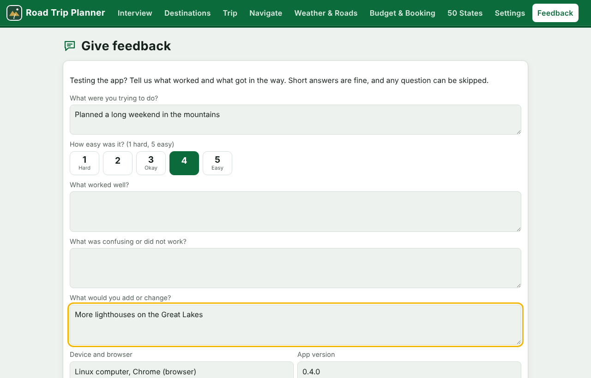
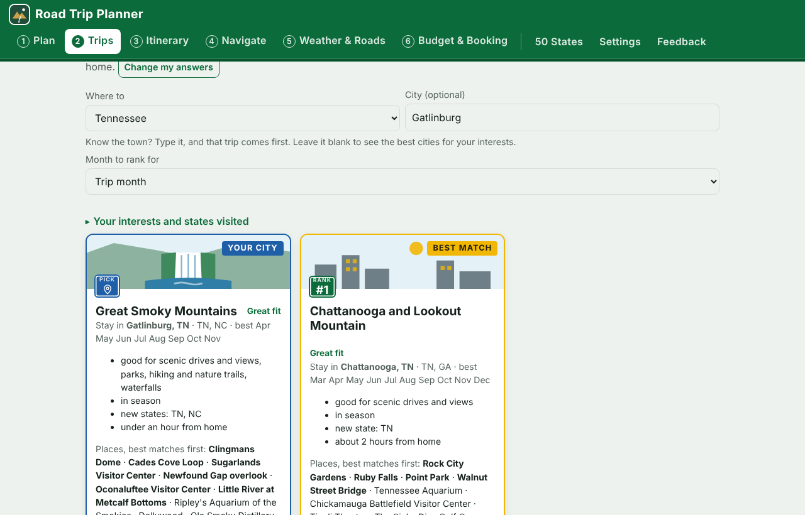
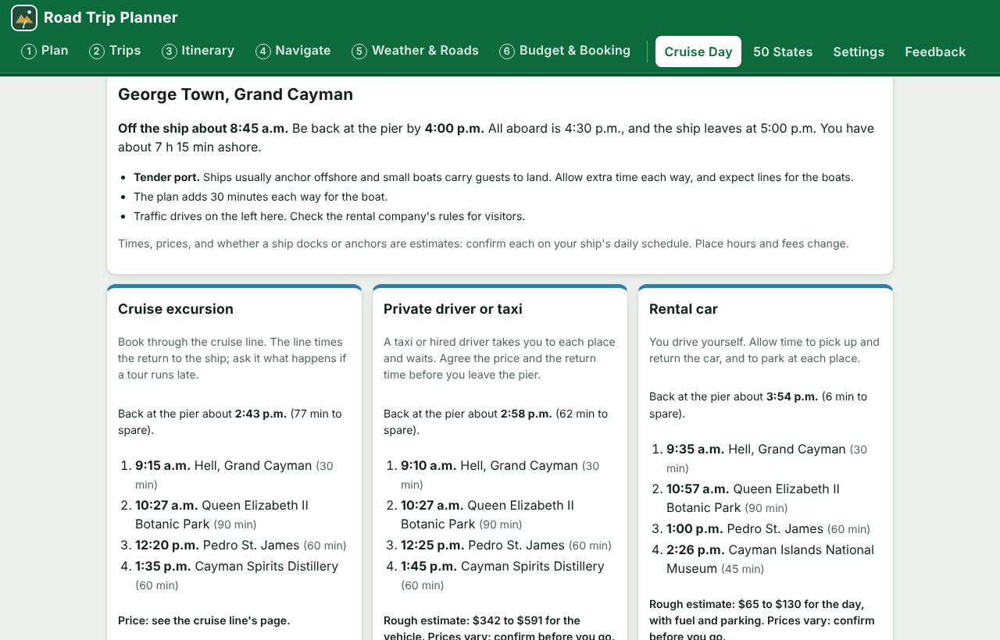
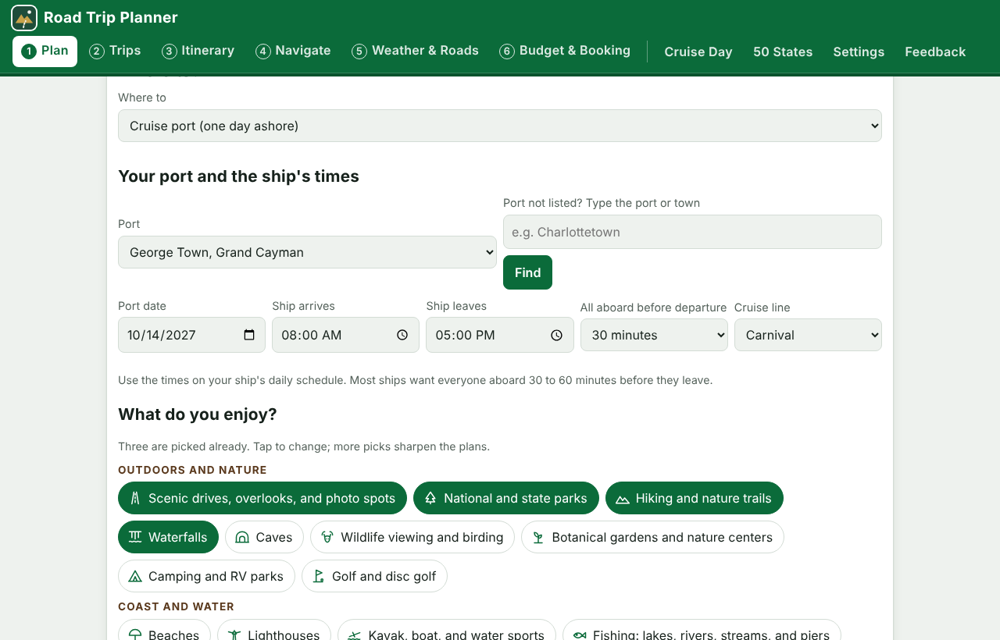

# Road Trip Planner

A free, self-contained road trip planner for one traveler or a small group. You
answer three questions (where you start, when and where, what you enjoy), it ranks
destinations that fit your interests, the season, and the drive from home (or puts
the town you already chose first), builds
and checks a day-by-day itinerary in one tap, and gives you phone navigation links,
a calendar file, map layers, live weather and road links, a budget, a booking
checklist, and a 50-state tracker. Every setting starts with a sensible value, so
you change only what is different for you. Coastal trips include lighthouses in every
ocean, Gulf, and Great Lakes state, every destination lists the experiences you can
only have there, and anglers get a link to buy each state's fishing license online.

It runs on a computer or a tablet. Your data stays on your device.

## Open the app (no download)

### [jbrady0850.github.io/road-trip-planner](https://jbrady0850.github.io/road-trip-planner/)

Tap the link on an iPad, Android tablet, phone, or computer. It opens in the web
browser. Nothing to download, install, or set up, and no account.


Reading this on a computer? Point your tablet's camera at the code to open the app
there.

### Put it on your home screen (recommended on a tablet)

| iPad | Android tablet |
|---|---|
| 1. Open the link in **Safari**. | 1. Open the link in **Chrome**. |
| 2. Tap **Share** (the square with an arrow pointing up, top right). | 2. Tap **Install app** if the app offers it, or tap the menu (three dots, top right). |
| 3. Tap **Add to Home Screen**, then **Add**. | 3. Tap **Add to Home screen** or **Install app**, then **Install**. |

Then open **Road Trips** from the home screen. It opens full screen like any other
app, keeps your saved trips, and still opens without a connection after the first
visit. Live weather, routing, and place search need a connection. The app shows
these same steps the first time you open it on a tablet, and again under
**Settings**.


Each device keeps its own trips. To move a trip to another device, use
**Settings, Back up all data**, then **Restore from file** on the other device.

## Six steps, one button at a time

The tabs across the top are numbered in the order you plan: **1 Plan**, **2 Trips**,
**3 Itinerary**, **4 Navigate**, **5 Weather & Roads**, **6 Budget & Booking**. Every
step ends with a **Next** button that takes you to the following step, and a
**Back** button. The last step ends with **Save my trip**. **Cruise Day**, 50 States,
Settings, and Feedback are always one tap away on the right.

Going ashore from a cruise ship? On step 1, set **Where to** to **Cruise port (one
day ashore)**. The step then asks for the port and the ship's times instead of your
home town and nights away, and step 2 shows the port-day plans in place of ranked
trips.

## Save your trips

The app keeps your trips on the device automatically, so they are there the next
time you open it. To keep a trip as a file you can store, copy, or open somewhere
else, open step **3 Itinerary** and tap **Save trip file**, or tap **Save my trip**
at the end of step 6.

| Device | Where the file goes |
|---|---|
| iPad or iPhone | A sheet opens: tap **Save to Files**, then pick **On My iPad** or **iCloud Drive** |
| Android tablet or phone | Your **Downloads** folder (Files app) |
| Computer, in a browser | Your **Downloads** folder |
| Computer, desktop window | A **Save** dialog opens so you choose the folder |

To open it again, on the same device or a different one, use **3 Itinerary, Load trip
file**. **Settings, Back up all data** saves everything at once: trips, settings,
and states visited. The itinerary, calendar, map, and links files save the same
way. Trip files also open in the command-line version, and its trip files open in
the app.

## See it

Screenshots use a sample traveler from Knoxville, TN; weather shown is sample data.

| | |
|---|---|
| **1. Three questions.** Where you start (type it or tap Use my location), when and where (a state, plus a city if you know it), and what you enjoy, in four groups. Pace and comfort presets fill in everything else.  | **2. Ranked trips.** Best match first, with plain-word fit, the reasons, and each city's places ordered by your interests. Pick a state to rank only its cities.  |
| **3. Trip, built and checked in one tap.** Stops are one line each; tap Edit to change one. Free days offer nearby day trips.  | **4. Navigate.** Google Maps routes per day, Waze links per stop, calendar, CSV, and KML downloads.  |
| **5. Weather and roads.** National Weather Service forecasts and alerts, plus official state road-condition pages.  | **6. Budget and booking.** Estimate against your cap and a checklist with booking links.  |
| **7. 50-state tracker.** Tap states visited; the current trip is outlined.  | **8. Tablet.** The same app on an iPad or Android tablet, added to the home screen.  |
| **9. Give feedback.** Testers answer a few questions; one tap fills in the GitHub form, or saves the answers as a file.  | **10. Know the town?** Type it in City; that trip comes first, and the rest of the state follows, ranked.  |
| **11. A day in port.** Pick the port and the ship's times; compare a cruise excursion, a private driver, and a rental car.  | **12. Start from a port.** On step 1, Where to takes a cruise port; the port and the ship's times replace home and nights.  |

## Run it from a download (optional)

The link above is all most people need. To run a copy from your own computer
instead:

| Device | How |
|---|---|
| Windows | Double-click `Start-Windows.bat` |
| Mac | Double-click `Start-Mac.command` (first time: right-click, Open) |
| Linux | Run `./start-linux.sh` |
| Any computer without Python | Open `app/index.html` in Chrome, Edge, Firefox, or Safari |
| iPad, Android tablet, or phone | Open the link above; no download needed |

The start scripts use Python 3.9 or newer (standard library only) to run the app on
`http://127.0.0.1` on your own computer. With the optional `pywebview` package
(`pip install pywebview`) it opens in its own window instead of your browser.

**Host your own copy:** fork this repository, open Settings, Pages, and set
Source to "GitHub Actions". The included workflow (`.github/workflows/pages.yml`)
publishes the `app` folder to your own web address. Any static web host also
works: upload the `app` folder as is.

## What it does

1. **Three questions:** where you start (type a town, or tap **Use my location**),
   when, where, and for how many nights, and what you enjoy. **Where to** takes a
   state, and a **City** when you already know the town: a catalog town (with
   suggestions as you type) goes straight to the top, and any other town is looked
   up on the map and built from the catalog places within about an hour's drive.
   Leave City blank to see the best cities for your interests. Interests come in four
   groups, 24 in all:
   - **Outdoors and nature:** scenic drives, overlooks, and photo spots; national and
     state parks; hiking and nature trails; waterfalls; caves; wildlife viewing and
     birding; botanical gardens and nature centers; camping and RV parks; golf and
     disc golf.
   - **Coast and water:** beaches; lighthouses; kayak, boat, and water sports;
     fishing at lakes, rivers, streams, and piers.
   - **Culture and entertainment:** history, museums, and historic sites; small
     towns and shopping; food and local dining; live music and performing arts;
     breweries, wineries, and distilleries; art galleries and craft markets; theme
     parks and attractions.
   - **Family and relaxation:** family-friendly attractions; spas, hot springs, and
     wellness; farmers markets and orchards; festivals, fairs, and holiday lights.

   Three interests are picked for you; change them freely. Optional: **Adjust the details** for a pace
   preset (Relaxed, Balanced, Cover ground), a comfort preset (Economy, Mid-range,
   Comfort), and every individual setting underneath, all pre-filled.
2. **Ranked trips:** a built-in catalog of 54 destinations and 444 places covering all 50 states is
   ranked for your interests, the season, new states, and the drive from home. Each
   card says why in plain words (Great fit, Good fit, Far for this trip), lists the
   city's places with your best matches first, and shows what you can only do there
   (Only here). Choose a state to see only that state's cities, numbered from the
   best fit down. A state with fewer than five catalog trips also shows the nearest
   drive-to trips in other states, marked **Near** and the state's name, so there are
   always at least five to choose from (Alaska and Hawaii are fly-and-drive, so they
   get none). Pick **Lighthouses** to bring coastal trips to the top: every
   ocean, Gulf, and Great Lakes state has at least one lighthouse you can visit or
   see from shore (Alaska is the exception; see [docs/LIMITS.md](docs/LIMITS.md)).
   Pick **Fishing** and the Plan page shows the license link for the state you chose
   right away; every fishing trip then shows a link to its state's official page for
   buying a fishing license online, on the trip card, the itinerary, the booking
   checklist, and the saved itinerary.
3. **One-tap itinerary:** tap a trip and the app drafts it, checks it, and fetches
   real drive times. Places that match your interests go into the days first. Drive
   days fit your daily limit; sightseeing days are packed to your pace; the day you arrive sees sights on the way in so check-in lands on time;
   days left over become free days with nearby ideas and an **Add a day trip** button.
4. **Recommended for your interests:** every itinerary lists 5 to 8 more catalog
   places, best matches within a day trip of where you stay first; when too few
   match, the closest other places fill the list, each marked **Not one of your
   interests**, and places farther than a day trip come last, marked **beyond a day
   trip**. A fly-and-drive trip lists only places on its own island or area, so the
   list can be shorter. Tap **Pick** on the ones you want and choose a day for each.
   **Show other places** keeps your picks and swaps the rest for places you have not seen
   yet. **Add my picks to the trip** puts them in their days and re-checks the drive
   times for those days.
5. **Make my trip unique:** a button on the Trips page and the Itinerary page asks
   five questions: what would make the trip stand out (natural wonders, sunrise and
   night sights, living history, the water, wildlife, local flavor), how unusual the
   picks should be, how much effort is fine, how far you would go, and anything else
   in your own words. It then shows options grouped by area, at least eight when
   the catalog has that many within reach: catalog places, with the reason each one
   fits (for example, "only 10 places in the app have caves"), and Only-here
   experiences. With your own AI key, ideas from the AI
   join the list, each marked **AI** and UNVERIFIED. Pick any number. On the Trips
   page, **Build my unique trip** bases the trip in the area with the most picks and
   puts your picks first; picks too far for a day trip are listed on the itinerary
   instead. On the Itinerary page, **Add my picks to the trip** adds them to your
   free days or the days with the fewest stops. "Unusual" means a kind of place that
   is rare in this app's catalog; the app has no data on crowds. Cruise port days do
   not offer the interview.
6. **Plan checker** (runs by itself after every draft): times out of order, not enough time to drive between stops,
   daily drive cap, check-in far from your target, timed-entry margin, arriving after
   sunset, days that do not start where the last one ended, and stops without
   coordinates.
7. **Drive times:** real drive times from the free OSRM router, applied to every
   arrival and departure automatically; rerun any time from **Tools** on the Itinerary page.
8. **Navigate:** Google Maps links with every stop for each day (split automatically
   above the Google Maps app limit of 9 waypoints), Waze links for each stop (Waze
   takes one destination per link), a calendar file, My Maps CSV pins, and KML route
   layers.
9. **Weather and roads:** live National Weather Service forecasts and active alerts
   for every stop, official FHWA road-condition pages for each state on the trip, and
   National Park Service alerts.
10. **Budget and booking:** lodging, fuel, food, attractions, and contingency against
   your cap, plus a booking checklist with lodging search links (and fishing license
   links when you fish). You book; the app never reserves or pays.
11. **Cruise port days:** pick **Cruise port** in Where to on step 1, or open the
   **Cruise Day** tab, to plan one day in port. Pick a port from 192 in the
   Caribbean, Mexico, Central and South America, Canada and New England, Alaska,
   Hawaii, US homeports, the Mediterranean and Atlantic islands, Northern Europe and
   the British Isles, Asia and the Pacific, and Africa and the Middle East. Or type
   the port or town and tap **Find** (or press Enter or Go): a name on the list, such
   as "Montego Bay Jamaica" or "Rome", picks that port. Any other port is found on
   OpenStreetMap and borrows the places of listed ports in the same country within
   about an hour in a straight line; some may be across water, so check that you can
   reach each one. Enter when the ship arrives and leaves; the app allows
   15 minutes to get off the ship, extra time for tender boats, and an all-aboard
   buffer you choose (30 to 90 minutes). It fits places that match the same 24
   interests between those times; when too few match, it fills the day with other
   nearby places and marks each one **Not one of your interests**. The plans come
   three ways side by side: a **cruise excursion**
   (links to the shore excursion pages of nine cruise lines, plus web searches), a
   **private driver or taxi** (with Viator and GetYourGuide searches for the port),
   and a **rental car**. Each plan shows when you are
   back at the pier and how many minutes you have to spare, with rough price
   estimates. **Use this plan as my itinerary** turns it into a one-day trip that
   works with Navigate and the saved itinerary. The app does not book anything, and
   it cannot see excursion prices or availability. Whether a port is a tender port
   changes by call, so confirm it on your ship's daily schedule.
12. **50 states:** tap to mark states visited; finished trips mark their states.
13. **Optional AI itineraries:** in Settings, pick Claude (Anthropic), ChatGPT
    (OpenAI), Gemini (Google), or Grok (xAI), and paste your own API key from that
    provider's key page (linked there). The AI can then write a custom itinerary,
    which goes through the same checks, and add ideas to Make my trip unique.
    Everything an AI model writes is marked **AI**, with the provider and model named,
    on the trip, each day plan, and each stop, and "(AI)" follows those stops in the
    saved itinerary, links page, calendar, CSV, and map files. The key stays in your
    browser and goes only to that provider; backups leave every key out.
14. **Feedback:** the **Feedback** tab asks testers what they tried, how easy it
    was, what worked, and what to change. **Open on GitHub** fills in the tester form
    for them; **Save as a file** works without a GitHub account.

## Suggest a change

Ideas, problems, and new destinations are welcome, no code needed.

- **Tester feedback:** the app's **Feedback** tab, or the
  [tester form](https://github.com/JBrady0850/road-trip-planner/issues/new?template=tester-feedback.yml).
- **Talk an idea through:** [Ideas discussions](https://github.com/JBrady0850/road-trip-planner/discussions/categories/ideas).
- **Report a problem:** [problem form](https://github.com/JBrady0850/road-trip-planner/issues/new?template=bug-report.yml).
- **Suggest an improvement:** [improvement form](https://github.com/JBrady0850/road-trip-planner/issues/new?template=suggest-improvement.yml).

Posting on GitHub needs a free account, and these pages are public, so leave out your
address and booking numbers. To send code or catalog changes, see
[CONTRIBUTING.md](CONTRIBUTING.md).

## Files

```
app/                 the app (open index.html)
  data/catalog.js    destinations: edit or add your own
  data/states.js     50 states, road-condition links, fishing license pages
  data/ports.js      192 cruise ports with places near each (Cruise Day tab)
  js/engine.js       scoring, drafting, checker, links, exports (no network)
  js/services.js     place search, routing, weather, optional AI
  js/app.js          interface
desktop/             Python launcher for Windows, Mac, Linux
roadtrip/            Python command-line engine for power users (same checks)
examples/            sample trip file
prompts/             master prompt template for using an AI assistant as a planner
docs/                limits, catalog notes, privacy, roadmap
tests/               Python unit tests and browser checks
.github/             issue forms for feedback, problems, and ideas; workflows
```

## Power users: command line

```
pip install -r requirements.txt
python -m roadtrip check examples/sample_trip.json --route
python -m roadtrip links examples/sample_trip.json
python -m roadtrip export examples/sample_trip.json --route --out output
ROADTRIP_NWS_USER_AGENT="(my-roadtrip, me@example.com)" python -m roadtrip weather examples/sample_trip.json
```

## Tests

```
python -m pytest -q          # engine unit tests (Python and browser engine)
python tests/ui_smoke.py     # full app flow in headless Chromium (pip install playwright)
python tests/tablet_smoke.py # iPad and Android install steps, icons, and layout
python tests/save_smoke.py   # save and reopen a trip in every version
```

## Data sources and credits

Place search: OpenStreetMap Nominatim (© OpenStreetMap contributors, ODbL). Routing:
OSRM public demo server (light use; set your own server in Settings). Weather:
National Weather Service api.weather.gov. Road conditions: Federal Highway
Administration state traffic pages. Hours, prices, and closures change; verify
before you travel. See [docs/LIMITS.md](docs/LIMITS.md).

## License

MIT. See [LICENSE](LICENSE).
