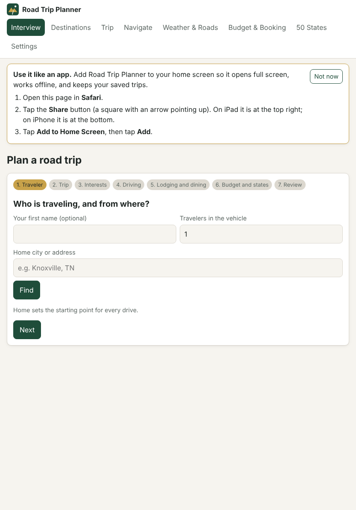
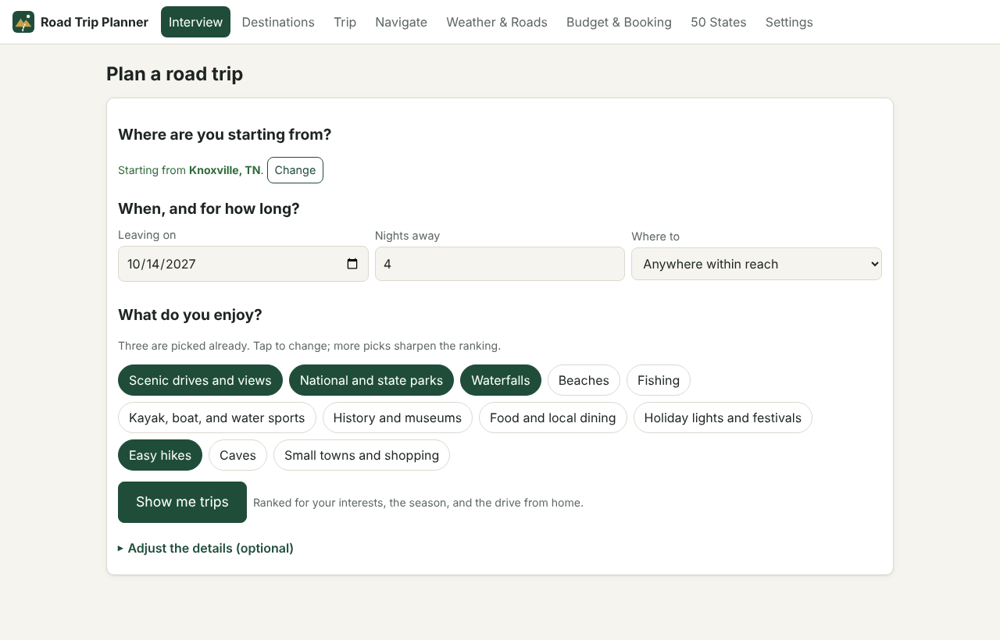
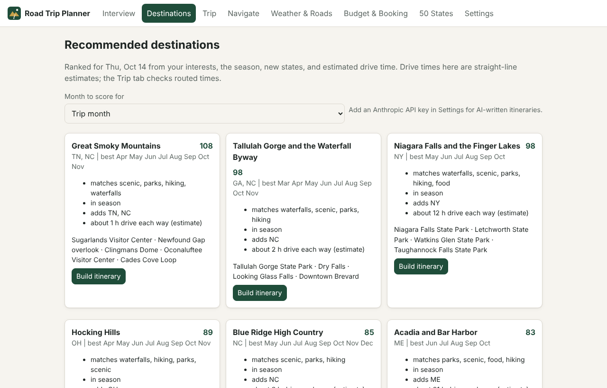
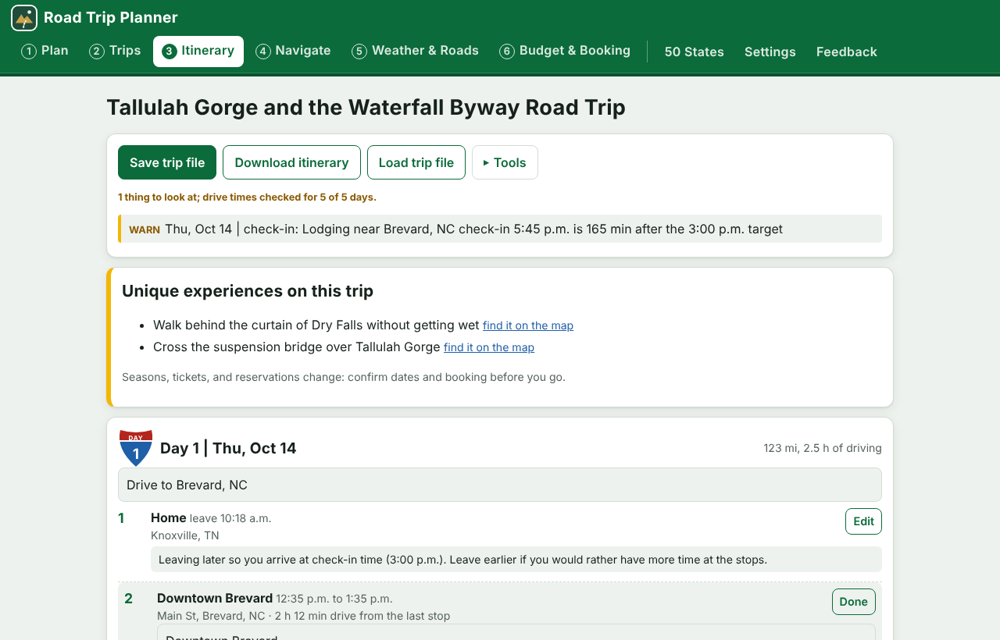
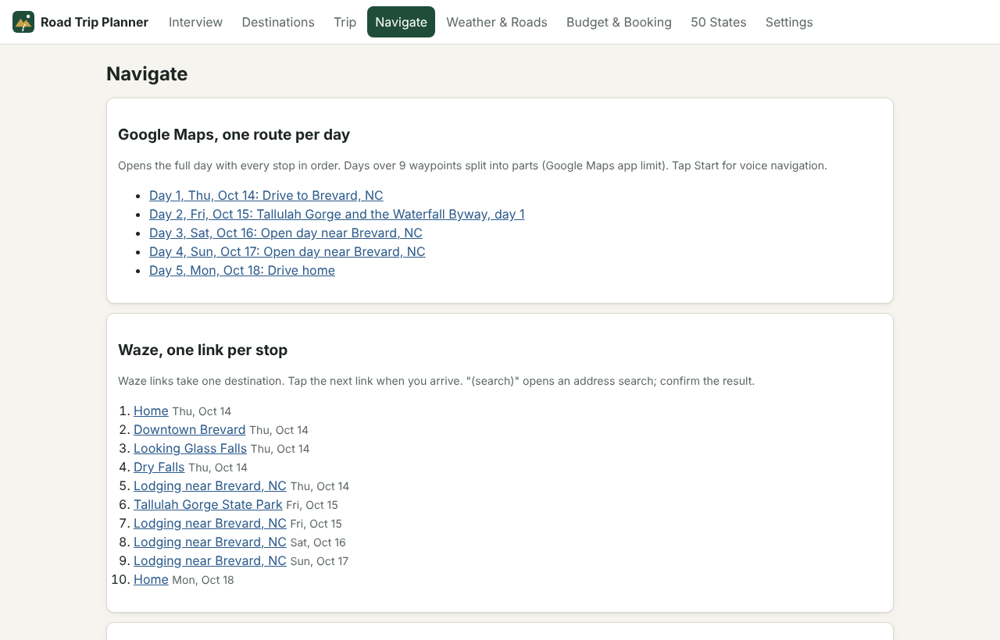
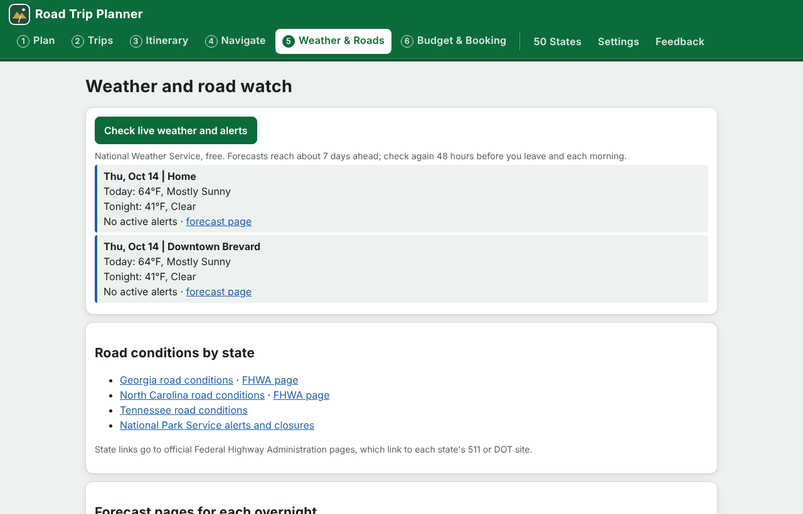
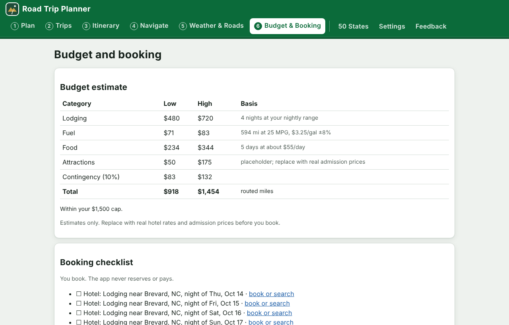
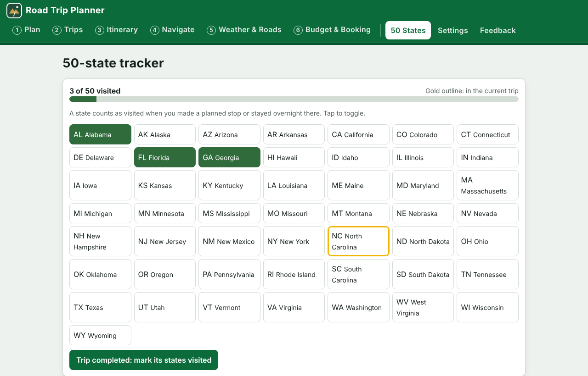
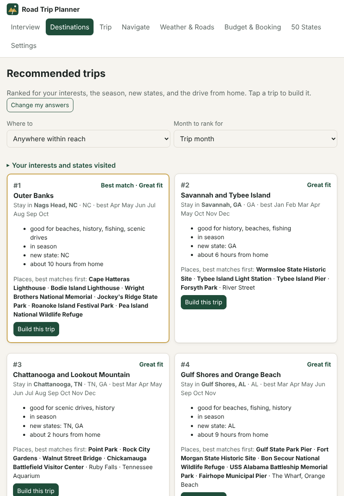

# Road Trip Planner

A free, self-contained road trip planner for one traveler or a small group. You
answer a short interview, it recommends destinations that fit your interests,
season, and driving limits, drafts a day-by-day itinerary, checks the plan for
mistakes, and gives you phone navigation links, a calendar file, map layers, live
weather and road links, a budget, a booking checklist, and a 50-state tracker.

It runs on a computer or a tablet. Your data stays on your device.

## Open the app (no download)

### [jbrady0850.github.io/road-trip-planner](https://jbrady0850.github.io/road-trip-planner/)

Tap the link on an iPad, Android tablet, phone, or computer. It opens in the web
browser. Nothing to download, install, or set up, and no account.


Reading this on a computer? Point your tablet's camera at the code to open the app
there.

### Put it on your home screen (recommended on a tablet)

| iPad | Android tablet |
|---|---|
| 1. Open the link in **Safari**. | 1. Open the link in **Chrome**. |
| 2. Tap **Share** (the square with an arrow pointing up, top right). | 2. Tap **Install app** if the app offers it, or tap the menu (three dots, top right). |
| 3. Tap **Add to Home Screen**, then **Add**. | 3. Tap **Add to Home screen** or **Install app**, then **Install**. |

Then open **Road Trips** from the home screen. It opens full screen like any other
app, keeps your saved trips, and still opens without a connection after the first
visit. Live weather, routing, and place search need a connection. The app shows
these same steps the first time you open it on a tablet, and again under
**Settings**.



Each device keeps its own trips. To move a trip to another device, use
**Settings, Back up all data**, then **Restore from file** on the other device.

## Save your trips

The app keeps your trips on the device automatically, so they are there the next
time you open it. To keep a trip as a file you can store, copy, or open somewhere
else, open the **Trip** tab and tap **Save trip file**.

| Device | Where the file goes |
|---|---|
| iPad or iPhone | A sheet opens: tap **Save to Files**, then pick **On My iPad** or **iCloud Drive** |
| Android tablet or phone | Your **Downloads** folder (Files app) |
| Computer, in a browser | Your **Downloads** folder |
| Computer, desktop window | A **Save** dialog opens so you choose the folder |

To open it again, on the same device or a different one, use **Trip, Load trip
file**. **Settings, Back up all data** saves everything at once: trips, settings,
and states visited. The itinerary, calendar, map, and links files save the same
way. Trip files also open in the command-line version, and its trip files open in
the app.

## See it

Screenshots use a sample traveler from Knoxville, TN; weather shown is sample data.

| | |
|---|---|
| **1. Interview.** Seven short steps: home, dates, interests, driving, lodging and dining, budget, states visited.  | **2. Destinations.** Ranked for your interests, the season, new states, and drive time, with the reasons shown.  |
| **3. Trip and plan check.** Edit every stop; the checker flags problems like a late hotel check-in.  | **4. Navigate.** Google Maps routes per day, Waze links per stop, calendar, CSV, and KML downloads.  |
| **5. Weather and roads.** National Weather Service forecasts and alerts, plus official state road-condition pages.  | **6. Budget and booking.** Estimate against your cap and a checklist with booking links.  |
| **7. 50-state tracker.** Tap states visited; the current trip is outlined.  | **8. Tablet.** The same app on an iPad or Android tablet, added to the home screen.  |

## Run it from a download (optional)

The link above is all most people need. To run a copy from your own computer
instead:

| Device | How |
|---|---|
| Windows | Double-click `Start-Windows.bat` |
| Mac | Double-click `Start-Mac.command` (first time: right-click, Open) |
| Linux | Run `./start-linux.sh` |
| Any computer without Python | Open `app/index.html` in Chrome, Edge, Firefox, or Safari |
| iPad, Android tablet, or phone | Open the link above; no download needed |

The start scripts use Python 3.9 or newer (standard library only) to run the app on
`http://127.0.0.1` on your own computer. With the optional `pywebview` package
(`pip install pywebview`) it opens in its own window instead of your browser.

**Host your own copy:** fork this repository, open Settings, Pages, and set
Source to "GitHub Actions". The included workflow (`.github/workflows/pages.yml`)
publishes the `app` folder to your own web address. Any static web host also
works: upload the `app` folder as is.

## What it does

1. **Interview:** home, dates and nights, interests (scenic, parks, waterfalls,
   beaches, fishing, water sports, history, food, holiday lights, easy hikes, caves,
   towns), daily drive limit, start time, fuel economy, vehicle height, lodging brand
   and nightly range, preferred check-in time, diet and dining limits, budget cap,
   and the states you have already visited.
2. **Destinations:** a built-in catalog of 49 destinations covering all 50 states
   is scored on your interests, the season, new states, and estimated drive time.
3. **Itinerary draft:** drive days sized to your daily limit, sightseeing days that
   spread the stops evenly, nearby stops added when you would reach the hotel early,
   and open days when stops run out.
4. **Plan checker:** times out of order, not enough time to drive between stops,
   daily drive cap, check-in far from your target, timed-entry margin, arriving after
   sunset, days that do not start where the last one ended, and stops without
   coordinates.
5. **Route check and re-time:** real drive times from the free OSRM router, then
   one tap rebuilds every arrival and departure from those times.
6. **Navigate:** Google Maps links with every stop for each day (split automatically
   above the Google Maps app limit of 9 waypoints), Waze links for each stop (Waze
   takes one destination per link), a calendar file, My Maps CSV pins, and KML route
   layers.
7. **Weather and roads:** live National Weather Service forecasts and active alerts
   for every stop, official FHWA road-condition pages for each state on the trip, and
   National Park Service alerts.
8. **Budget and booking:** lodging, fuel, food, attractions, and contingency against
   your cap, plus a booking checklist with lodging search links. You book; the app
   never reserves or pays.
9. **50 states:** tap to mark states visited; finished trips mark their states.
10. **Optional AI itineraries:** add your own Anthropic API key in Settings to have
    Claude write a custom itinerary, which then goes through the same checks.

## Files

```
app/                 the app (open index.html)
  data/catalog.js    destinations: edit or add your own
  data/states.js     50 states and road-condition links
  js/engine.js       scoring, drafting, checker, links, exports (no network)
  js/services.js     place search, routing, weather, optional AI
  js/app.js          interface
desktop/             Python launcher for Windows, Mac, Linux
roadtrip/            Python command-line engine for power users (same checks)
examples/            sample trip file
prompts/             master prompt template for using an AI assistant as a planner
docs/                limits, catalog notes, privacy, roadmap
tests/               Python unit tests and a browser smoke test
```

## Power users: command line

```
pip install -r requirements.txt
python -m roadtrip check examples/sample_trip.json --route
python -m roadtrip links examples/sample_trip.json
python -m roadtrip export examples/sample_trip.json --route --out output
ROADTRIP_NWS_USER_AGENT="(my-roadtrip, me@example.com)" python -m roadtrip weather examples/sample_trip.json
```

## Tests

```
python -m pytest -q          # engine unit tests
python tests/ui_smoke.py     # full app flow in headless Chromium (pip install playwright)
python tests/tablet_smoke.py # iPad and Android install steps, icons, and layout
python tests/save_smoke.py   # save and reopen a trip in every version
```

## Data sources and credits

Place search: OpenStreetMap Nominatim (© OpenStreetMap contributors, ODbL). Routing:
OSRM public demo server (light use; set your own server in Settings). Weather:
National Weather Service api.weather.gov. Road conditions: Federal Highway
Administration state traffic pages. Hours, prices, and closures change; verify
before you travel. See [docs/LIMITS.md](docs/LIMITS.md).

## License

MIT. See [LICENSE](LICENSE).
